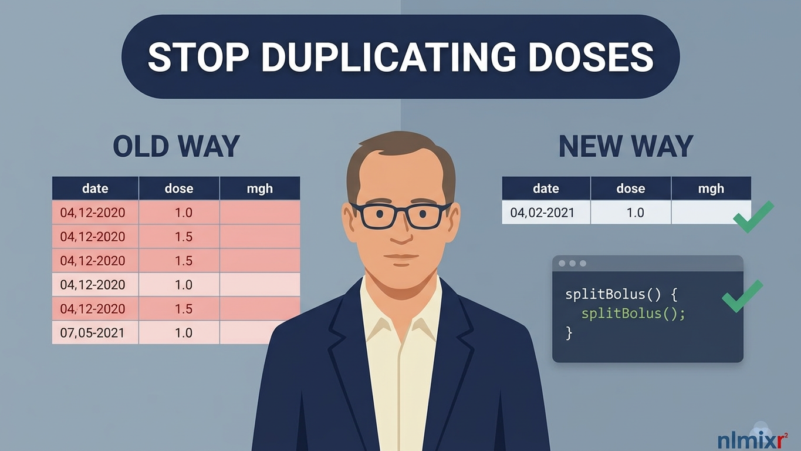

{width=100% fig-alt="Illustration titled Stop Duplicating Doses: a dose table full of repeated rows on the left, and on the right a single dose row beside a splitBolus() snippet, each marked with a green check"}

_Original post on the nlmixr2 project blog is [here](https://blog.nlmixr2.org/blog/2026-11-04-dual-absorption/)._

The nlmixr2 Working Group continues to expand what open source R tooling can support in pharmacometrics. In a new post, Matthew Fidler introduces four splitting directives in `rxode2` and `nlmixr2`: `splitBolus()`, `splitInfusion()`, `splitInfusionBolus()`, and `splitBolusInfusion()`. A directive in the `model({})` block takes each dose recorded against one compartment and sends a copy to each of several others. The dataset keeps one row per dose, the way it was given. Because `nlmixr2` estimates with `rxode2` models, the same directive works when you fit. It is in the current CRAN releases, `rxode2` 5.1.8 and `nlmixr2est` 7.2.1.

Each target receives the full amount unless `f()` assigns a share, and `alag()`, `dur()`, and `rate()` still set lag and infusion timing on each route. The post walks through a 60/40 fast and slow depot, a zero-order input combined with first-order absorption, infusions already recorded in the data, and rescue doses the model adds while it is solving. `nlmixr2` applies the directive with FOCEi, SAEM, and the other estimation methods, and a VPC and the other post-fit tools keep that one-row-per-dose data. The dataset names only the source compartment.

Watch the 7-minute narrated walkthrough: [https://youtu.be/RCjb5hoFFDY](https://youtu.be/RCjb5hoFFDY)

Read the full post from the nlmixr2 blog: [Dual absorption with one dose record](https://blog.nlmixr2.org/blog/2026-11-04-dual-absorption/)

## Why nlmixr2?

The vision of nlmixr2 is to develop a R-based open source nonlinear mixed-effects modeling software package that can compete with commercial pharmacometric tools and is suitable for regulatory submissions.

In short, the goal of nlmixr2 is to support easy and robust nonlinear mixed effects models in R.

From: [https://github.com/nlmixr2/nlmixr2](https://github.com/nlmixr2/nlmixr2)

## Get involved in the nlmixr2 working group

The nlmixr2 working group is open to anyone interested in contributing to the project. You can get involved by:

Main repo: [https://github.com/nlmixr2/nlmixr2](https://github.com/nlmixr2/nlmixr2)  
Issues: [https://github.com/nlmixr2/nlmixr2/issues](https://github.com/nlmixr2/nlmixr2/issues)  
Discussions: [https://github.com/nlmixr2/nlmixr2/discussions](https://github.com/nlmixr2/nlmixr2/discussions)
